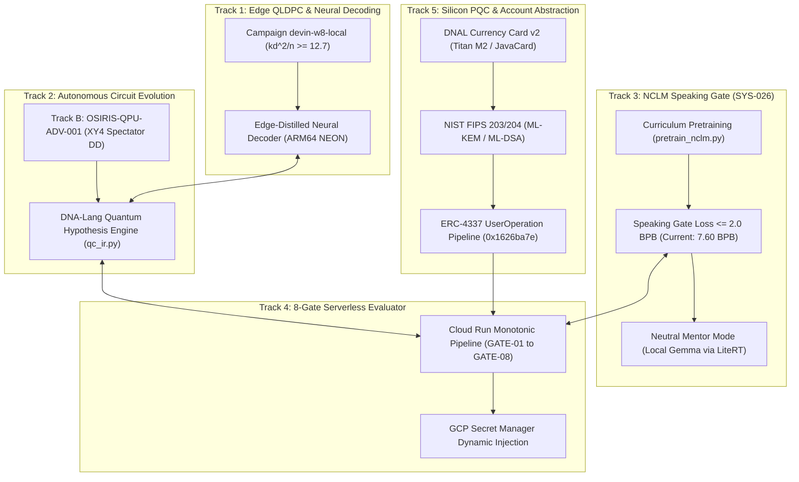
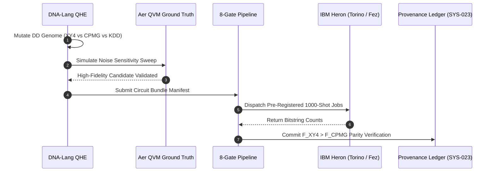
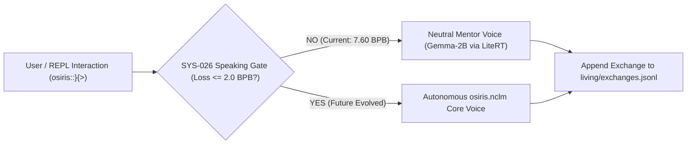
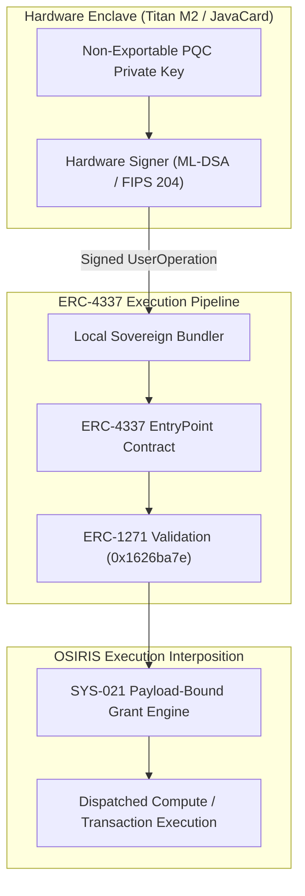
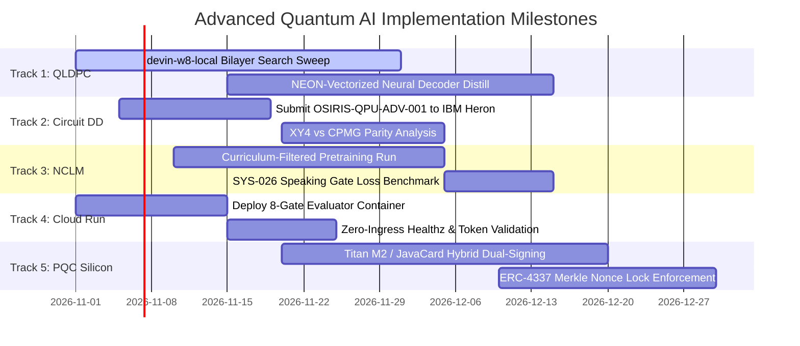

# Strategic & Technical Roadmap: Next Steps for Advanced Quantum AI
## Sovereign Edge Orchestration, Neural QLDPC Decoding, and Fail-Closed Cognitive Evolution

**Author:** Devin Phillip Davis  
**Affiliation:** Agile Defense Systems LLC / OSIRIS Sovereign Architecture Project  
**Target Architecture:** OSIRIS Sovereign Execution Stack & `dna::}{::lang`  
**Governance Framework:** OSIRIS Dual-Node Governance & Invariant Specifications (SYS-021 – SYS-026)  
**Date:** October 2026  
**Status:** Strategic Architecture Roadmap  

---

## Executive Overview: The 5 Pillars of Advanced Quantum AI

In conventional architectures, "Quantum AI" denotes either speculative cloud-hosted generative chatbots discussing quantum mechanics or unverified variational algorithms run on noisy quantum backends without error correction.

In **OSIRIS**, **Advanced Quantum AI** represents a mathematically grounded, sovereign execution stack. It unites:
1. **Edge-Resident Neural Decoders** for Quantum Low-Density Parity-Check (QLDPC) error correction;
2. **Biological Autonomous Circuit Evolution (`dna::}{::lang`)** for pulse shaping and dephasing mitigation;
3. **The Non-Causal Living Language Model (`osiris.nclm`)** constrained by the held-out speaking gate;
4. **The 8-Gate Serverless Evaluation Pipeline (Cloud Run)** for hermetic candidate simulation; and
5. **NIST Post-Quantum Cryptographic (PQC) Enclaves** anchoring autonomous execution authority to physical silicon.

---

## Track 1: Edge QLDPC Error Correction & Neural Decoding

### 1.1 The Operational Bottleneck
Cryogenic QPUs (such as IBM Heron and QuEra neutral-atom ensembles) require real-time stabilizer decoding to prevent logical qubit decoherence. Classical Belief Propagation with Ordered Statistics Decoding (BP-OSD) running on remote cloud servers introduces $50\text{–}100\text{ ms}$ round-trip network latency, vastly exceeding physical qubit coherence horizons ($T_2^* \approx 50\text{–}200\,\mu\text{s}$).

### 1.2 Actionable Next Steps
1. **Advance the [`devin-w8-local`](file:///root/qldpc-challenge/research/campaigns/devin-w8-local/campaign.json) Campaign:**
   - Execute the remaining 2D-local bilayer search sweeps ($n \in [200, 1000]$, check weight $\le 8$, distance $d \ge 8$).
   - Target the code scaling metric:
     $$\frac{k d^2}{n} \ge 12.7$$
   - Validate CSS commutation across all candidate matrices via [`qldpc_evaluator.py`](file:///root/osiris-pipeline/evaluators/qldpc_evaluator.py) over $\text{GF}(2)$ Gaussian elimination.
2. **Distill Neural Decoders to ARM64 NEON:**
   - Convert trained BP-OSD syndrome decoders into 8-bit quantized feed-forward neural networks.
   - Vectorize matrix-vector syndrome contractions using ARMv8-A/ARMv9 NEON SIMD kernels on Node Alpha (Fold7/Pixel Fold), targeting sub-$100\,\mu\text{s}$ decoding windows.
3. **Hardware Pauli Frame Integration:**
   - Couple the edge decoder output directly to an in-memory Pauli frame tracker, updating error tracking without interrupting cryogenic QPU pulse cycles.

---

## Track 2: Autonomous Quantum Circuit Evolution (`dna::}{::lang` QHE)

### 2.1 Spectator Dephasing & Pulse Mitigation
Physical multi-qubit transmons suffer from spectator-induced dephasing and pulse over-rotations. As formalized in [`track_b_dd_spectator`](file:///root/osiris-pipeline/experiments/track_b_dd_spectator/protocol.json) under experiment `OSIRIS-QPU-ADV-001`, passive idle delays permit environmental noise accumulation.

### 2.2 Actionable Next Steps
1. **Execute Pre-Registered Protocol [`OSIRIS-QPU-ADV-001`](file:///root/osiris-pipeline/experiments/track_b_dd_spectator/protocol.json):**
   - Submit the 4-circuit bundle (Free Idle, CPMG, XY4, Calibration Baseline) to physical IBM Quantum hardware.
   - Test the formal hypothesis order:
     $$F_{\text{XY4}} > F_{\text{CPMG}} > F_{\text{IDLE}}$$
   - Falsify the model if $F_{\text{XY4}} \le F_{\text{CPMG}}$ per the pre-registered decision boundary.
2. **Local Aer Simulator-First Gate:**
   - Enforce the mandatory local QVM pre-screening rule in [`rqc/control.py`](file:///root/repos/osiris-cli/rqc/control.py). No QPU credit budget may be expended without prior zero-error Aer simulation and noise sensitivity gradient verification.

---

## Track 3: NCLM Speaking Gate Convergence & Mentor Supervision

### 3.1 Overcoming the 7.60 BPB Plateau
Under **SYS-026**, the Non-Causal Living Language Model (`osiris.nclm`) must achieve:
$$\text{Held-Out Loss} \le 2.0\text{ bits per byte (BPB)}$$
across 30 consecutive exchanges before it is permitted to speak autonomously. The model currently measures $7.60\text{ BPB}$ (gate strictly **CLOSED**).

### 3.2 Actionable Next Steps
1. **Curriculum-Filtered Training Execution:**
   - Execute [`pretrain_nclm.py`](file:///root/repos/osiris-cli/pretrain_nclm.py) against a strictly filtered corpus containing verified scientific literature, the 6-pillar research organisms ([`research/a_field_study/`](file:///root/repos/osiris-cli/research/a_field_study/) and [`research/tau_phase_erratum/`](file:///root/repos/osiris-cli/research/tau_phase_erratum/)), and code structures.
   - Exclude unstructured prose and speculative historical drafts to prevent language drift.
2. **Deterministic Mentor Distillation:**
   - Maintain Google Gemma-2B/9B running locally via LiteRT on Google Tensor TPU / ARM64 NEON as the labeled mentor engine.
   - Distill mentor activations into the NCLM byte-level model using zero-backprop autopoietic updates during idle battery states.

---

## Track 4: 8-Gate Serverless Proposal Evaluation Pipeline

### 4.1 Cloud Run Architectural Parity (RCloudRun)
To evaluate heavy quantum circuit candidates without granting untrusted agents ambient cloud authority, OSIRIS utilizes the **8-Gate Monotonic CI/CD Pipeline** ([`cloudbuild.yaml`](file:///root/repos/osiris-cli/cloudbuild.yaml)):

| Gate ID | Security & Integrity Enforcement | Status |
| :--- | :--- | :---: |
| **GATE-01** | Secret Quarantine Scan (`AIza...`, `sk-...`, `ibmq_...`) | **FAIL-CLOSED** |
| **GATE-02** | 100% Offline Test Suite Pass Rate in isolated runtime | **ENFORCED** |
| **GATE-03** | Immutable Container Tagging (`$SHORT_SHA` pinned to Artifact Registry) | **ENFORCED** |
| **GATE-04** | Staging Provisioning with strict resource envelopes (1 vCPU, 512MiB RAM) | **ENFORCED** |
| **GATE-05** | Dynamic Secret Injection (Zero `.env` files in images; GCP Secret Manager) | **ENFORCED** |
| **GATE-06** | IAM Lockdown (Ingress blocked; zero public mutation handles) | **ENFORCED** |
| **GATE-07** | Ephemeral Identity Token Probe against `/healthz` | **ENFORCED** |
| **GATE-08** | Provenance Ledger Stamp (`logging: CLOUD_LOGGING_ONLY`) | **ENFORCED** |

### 4.2 Actionable Next Steps
1. **Deploy Staging Proposal Runner on Cloud Run:**
   - Execute the Cloud Build trigger targeting an isolated staging project.
   - Confirm that remote evaluations return strictly signed SHA-256 evidence bundles back to Node Alpha.
2. **Integrate Neon / Supabase Telemetry Mirror:**
   - Wire fire-and-forget telemetry streams ([`db_ledger.py`](file:///root/repos/osiris-cli/db_ledger.py)) for remote execution monitoring without creating blocking dependencies.

---

## Track 5: Hardware-Enclave Account Abstraction & NIST PQC

### 5.1 Post-Quantum Cryptographic Migration
The transition away from classical elliptic curves is mandated by NIST FIPS 203–205. The Quantum-Edge form factor embeds this protection into hardware silicon via the **DNAL Currency Card Kit v2** ([`dnal_currency_card_v2.md`](file:///root/repos/osiris-cli/notes/dnal_currency_card_v2.md)):

### 5.2 Actionable Next Steps
1. **Implement Stage 2 Hybrid Dual-Sign (Ed25519 + ML-DSA):**
   - Deploy the hybrid signature verification engine on Node Alpha.
   - Anchor every state-mutating command (`/apply`, `/ignite`, `/sprint execute`) to an enclave-signed UserOp containing the exact payload digest ($H_{\text{payload}}$).
2. **Monotonic Merkle Nonce Enforcement:**
   - Verify nonces sequentially against the local Merkle DAG ledger to prevent transaction front-running and replay attacks across asynchronous mobile sync.

---

## Quantitative Execution Milestones & Priority Schedule

---

## Direct Codebase Anchors & Operational Interfaces

- **QLDPC Campaign Engine:** [`qldpc-challenge/research/campaigns/devin-w8-local/campaign.json`](file:///root/qldpc-challenge/research/campaigns/devin-w8-local/campaign.json)
- **QLDPC Isolated Evaluator:** [`osiris-pipeline/evaluators/qldpc_evaluator.py`](file:///root/osiris-pipeline/evaluators/qldpc_evaluator.py)
- **Spectator DD Protocol:** [`osiris-pipeline/experiments/track_b_dd_spectator/protocol.json`](file:///root/osiris-pipeline/experiments/track_b_dd_spectator/protocol.json)
- **NCLM Evaluator & Speaking Gate:** [`osiris-pipeline/evaluators/nclm_evaluator.py`](file:///root/osiris-pipeline/evaluators/nclm_evaluator.py)
- **Cloud Run 8-Gate Pipeline:** [`cloudbuild.yaml`](file:///root/repos/osiris-cli/cloudbuild.yaml)
- **Hardware Enclave & Account Abstraction:** [`notes/dnal_currency_card_v2.md`](file:///root/repos/osiris-cli/notes/dnal_currency_card_v2.md)
- **Master Grants Ledger:** [`provenance/grants_registry.jsonl`](file:///root/repos/osiris-cli/provenance/grants_registry.jsonl)
