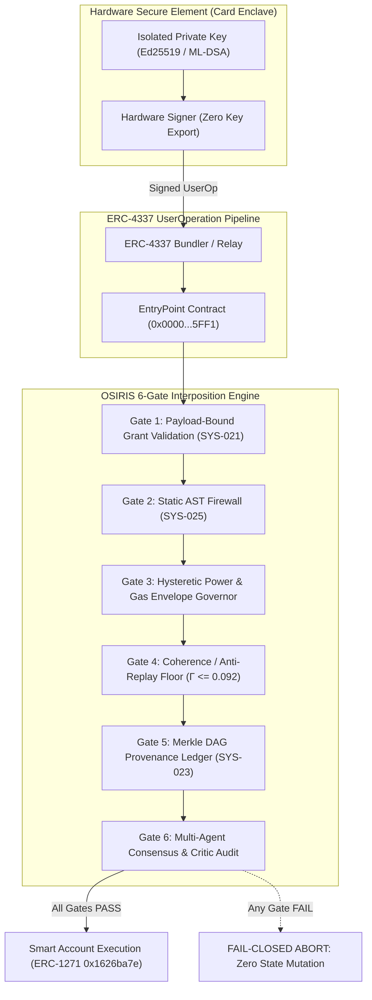

# DNAL Currency Card Kit v2: Hardware-Enclave Account Abstraction & Fail-Closed Provenance

## Executive & Technical Architecture

The DNAL Currency Card Kit v2 establishes a sovereign, post-quantum resilient hardware-enclave account abstraction architecture. It integrates ERC-4337 smart contract account abstraction with ERC-1271 off-chain signature validation, anchored by dedicated secure hardware enclaves (JavaCard / Secure Element) running Curve25519 (Ed25519) and NIST Post-Quantum Cryptography (PQC) algorithms.



---

## 1. Account Abstraction & Signature Protocol

### 1.1 ERC-4337 UserOperation Structure
Transactions originate from the sovereign card enclave packaged as ERC-4337 `UserOperation` structs:
- `sender`: The Smart Contract Account address.
- `nonce`: Monotonically increasing anti-replay nonce verified against on-chain state and OSIRIS Ledger.
- `initCode`: Account initialization bytecode (empty for deployed accounts).
- `callData`: Deterministic ABI-encoded execution intent.
- `callGasLimit`, `verificationGasLimit`, `preVerificationGas`: Bounded resource envelopes.
- `maxFeePerGas`, `maxPriorityFeePerGas`: Gas pricing ceilings.
- `paymasterAndData`: Optional sponsored gas validation.
- `signature`: Cryptographic signature emitted by the card enclave.

### 1.2 ERC-1271 Signature Validation
Contracts verify signatures via the standard `IERC1271` interface:
```solidity
function isValidSignature(bytes32 _hash, bytes memory _signature) external view returns (bytes4 magicValue);
```
- **Success Return**: `0x1626ba7e` (`bytes4(keccak256("isValidSignature(bytes32,bytes)"))`).
- **Failure Return**: `0xffffffff` or revert (fail-closed).
- **Enclave Anchor**: The contract asserts that `_signature` is signed by the Ed25519/ML-DSA public key registered during card genesis.

---

## 2. NIST Post-Quantum Cryptography (PQC) Migration Path

Per NIST FIPS 203–206, classical elliptic curves (Secp256k1, Ed25519) are vulnerable to Shor's algorithm on cryptanalytically relevant quantum computers (CRQCs). The Currency Card Kit v2 specifies a staged transition:

| Stage | Mechanism | Primary Standard | Purpose |
| :--- | :--- | :--- | :--- |
| **Stage 1 (Current)** | Ed25519 Enclave | RFC 8032 / FIPS 186-5 | High-speed, low-power secure element signing |
| **Stage 2 (Hybrid Transition)** | Dual-Sign (Ed25519 + ML-DSA) | FIPS 204 (CRYSTALS-Dilithium) | Classical backwards compatibility + quantum resistance |
| **Stage 3 (Full PQC Sovereign)**| Pure ML-DSA & ML-KEM | FIPS 203 (ML-KEM) & FIPS 204 | Quantum-native end-to-end encryption & execution |
| **Backup Stateless Scheme** | SLH-DSA | FIPS 205 (SPHINCS+) | Stateless hash-based fallback if lattice assumptions break |

---

## 3. The 6-Gate Interposition Architecture

1. **Gate 1: Payload-Bound Grant Validation (SYS-021)**: No card transaction can execute without an explicit cryptographic payload digest ($H_{\text{payload}}$) authorized by the cardholder enclave.
2. **Gate 2: Static AST Firewall (SYS-025)**: All proposal payloads and dynamic calls undergo static AST analysis; forbidden execution primitives (`exec`, `eval`, `compile`, `__import__`, `os.system`) trigger immediate fail-closed abort.
3. **Gate 3: Hysteretic Power & Gas Governor**: Real-time monitoring of device thermal envelope, battery level, and gas spend ceilings.
4. **Gate 4: Coherence & Anti-Replay Floor**: Verification of Merkle nonce chains and decoherence floor ($\Gamma \le 0.092$).
5. **Gate 5: Merkle DAG Provenance Ledger (SYS-023)**: Every signed UserOperation is committed to an immutable append-only ledger before broadcast.
6. **Gate 6: Multi-Agent Consensus**: IntentAgent, ArchitectAgent, and IndependentCriticVerifier must reach unanimity on safety bounds.

---

## 4. Pete Gordon Technical Briefing Summary

- **Hardware Isolation**: Private keys never leave the secure element silicon.
- **Fail-Closed Guarantee**: Any gate breach aborts execution with zero state mutation.
- **Quantum Sovereignty**: The hybrid signature framework guarantees immediate protection against harvest-now-decrypt-later attacks.
