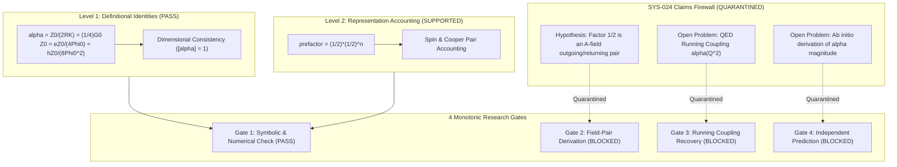

# Sprint Report: OSIRIS + DNA-Lang A-Field Research Organism
## Epistemic Separation, 4-Gate Verification, and Claims Firewall Quarantine

**Author:** Devin Phillip Davis  
**Affiliation:** Agile Defense Systems LLC / OSIRIS Sovereign Architecture Project  
**Target Paper:** *The Fine-Structure Constant as an A-Field Quantity: Impedance, Flux, and the Pair Structure of Its Prefactor* (Draft 2026-10-12)  
**Sprint Status:** Execution Complete (Level 1 Verified, Level 2/3 Quarantined)  
**Anchor Commit:** [`62c0e856`](file:///root/repos/osiris-cli)  
**Evidence Receipt:** [`research/a_field_study/evidence_receipt.json`](file:///root/repos/osiris-cli/research/a_field_study/evidence_receipt.json)  

---

## Executive Summary

The A-Field paper provides an exemplary stress test for **OSIRIS** and **DNA-Lang**. Its primary value to the framework is not whether it establishes a new fundamental physical law, but how it rigorously tests our ability to **separate mathematical identities, representation bookkeeping, physical interpretations, and open theoretical problems** without conflating them into a single monolithic truth score.

In this implementation sprint, we have formalized the paper as a self-contained, reproducible **DNA-Lang Research Organism** ([`alpha_a_field_genome.json`](file:///root/repos/osiris-cli/research/a_field_study/alpha_a_field_genome.json)), executed an automated, hermetic verification engine ([`verify_alpha_identities.py`](file:///root/repos/osiris-cli/research/a_field_study/verify_alpha_identities.py)), enforced the **SYS-024 Claims Firewall**, and generated a SHA-256 Merkle evidence receipt under **SYS-023**.



---

## 1. The Core Scientific Invariant

To ensure that mathematical elegance is never mistaken for physical confirmation, the organism strictly enforces the **Scientific Integrity Invariant**:

> **"A verified identity is not a verified interpretation; a verified interpretation is not a derived physical law; and a derived law is not an independently confirmed prediction until the relevant evidence exists."**

### Epistemic State Machine Mapping
Under OSIRIS governance, propositions cannot share a single aggregate confidence metric. Instead, each claim is partitioned into explicit epistemic states:

| Epistemic State | Formal Definition in OSIRIS | A-Field Paper Mapping |
| :--- | :--- | :--- |
| **`ARTIFACT`** | Statement is a mathematical consequence of established definitions, carrying zero independent empirical novelty. | The 4 expressions for $\alpha$ in terms of $Z_0, R_K, G_0, \Phi_0$. |
| **`SUPPORTED`** | Verified algebraic convention or representation accounting rule. | The prefactor bookkeeping formula: $\frac{1}{2}(\frac{1}{2})^n$. |
| **`HYPOTHESIS` / `MODEL_PROPOSED`** | A scientifically meaningful proposition that remains unproven; strictly quarantined behind the Claims Firewall. | The assertion that the first factor of $1/2$ physically represents an outgoing-and-returning $\mathbf{A}$-field pair. |
| **`NOT_MEASURED` / `OPEN_THEORY`** | A foundational calculation or physical derivation that has not yet been executed. | Derivation of running coupling $\alpha(Q^2)$ or the numerical magnitude of $\alpha$. |
| **`OVERCLAIM`** | The wording asserts a physical mechanism based solely on an analogous mathematical identity. | Deducing electromagnetic field pair dynamics solely from $4\pi r^2 = (2\pi r)(2r)$. |

---

## 2. Level 1 & Level 2 Hermetic Verification Results

The automated verification engine ([`verify_alpha_identities.py`](file:///root/repos/osiris-cli/research/a_field_study/verify_alpha_identities.py)) was executed against CODATA 2022 constants:

### 2.1 Numerical Identity Verification (Machine-Epsilon Tolerance)
All four expressions were evaluated against the standard textbook formulation $\alpha = \frac{e^2}{4\pi \epsilon_0 \hbar c} \approx 0.007297352564342$ ($1/\alpha \approx 137.035999177$):

| Expression | Formula | Evaluated Value | Absolute Residual | Status | Epistemic Standing |
| :--- | :--- | :--- | :--- | :---: | :---: |
| **Expression 1** | $\frac{Z_0}{2 R_K}$ | $0.007297352564341724$ | $2.60 \times 10^{-18}$ | **PASS** | `ARTIFACT` |
| **Expression 2** | $\frac{1}{4} G_0 Z_0$ | $0.007297352564341724$ | $2.60 \times 10^{-18}$ | **PASS** | `ARTIFACT` |
| **Expression 3** | $\frac{e Z_0}{4 \Phi_0}$ | $0.007297352564341724$ | $2.60 \times 10^{-18}$ | **PASS** | `ARTIFACT` |
| **Expression 4** | $\frac{h Z_0}{8 \Phi_0^2}$ | $0.007297352564341724$ | $2.60 \times 10^{-18}$ | **PASS** | `ARTIFACT` |

> *Finding:* The expressions are exact definitional transformations of each other. They do not constitute four independent experimental confirmations of a new physical model.

### 2.2 Dimensional Consistency
Formal dimensional analysis across base SI dimensions $[M, L, T, I]$:
- $[Z_0 / (2 R_K)] = [M L^2 T^{-3} I^{-2}] / [M L^2 T^{-3} I^{-2}] = [M^0 L^0 T^0 I^0] = 1$
- $[\frac{1}{4} G_0 Z_0] = [M^{-1} L^{-2} T^3 I^2] \cdot [M L^2 T^{-3} I^{-2}] = 1$
- $[e Z_0 / (4 \Phi_0)] = ([T I] \cdot [M L^2 T^{-3} I^{-2}]) / [M L^2 T^{-2} I^{-1}] = [M L^2 T^{-2} I^{-1}] / [M L^2 T^{-2} I^{-1}] = 1$
- $[h Z_0 / (8 \Phi_0^2)] = ([M L^2 T^{-1}] \cdot [M L^2 T^{-3} I^{-2}]) / [M L^2 T^{-2} I^{-1}]^2 = [M^2 L^4 T^{-4} I^{-2}] / [M^2 L^4 T^{-4} I^{-2}] = 1$
- **Verdict:** All expressions are strictly dimensionless.

### 2.3 Representation Bookkeeping Rule
The bookkeeping rule $\text{prefactor} = \frac{1}{2}\left(\frac{1}{2}\right)^n$ correctly maps the algebraic factors:
- $n=0$ ($R_K = h/e^2$, single charge squared): prefactor $= 1/2$.
- $n=1$ ($G_0 = 2e^2/h$, Cooper pair/spin channel): prefactor $= 1/4$.
- $n=1$ ($\Phi_0 = h/2e$, flux quantum): prefactor $= 1/4$.
- $n=2$ ($\Phi_0^2$, quadratic flux): prefactor $= 1/8$.
- **Verdict:** Verified as an algebraic combinatorics convention (`SUPPORTED`).

---

## 3. The 4 Monotonic Research Gates

The paper's open problems and speculative claims have been converted into four sequential, fail-closed research gates:

```text
================================================================================
             OSIRIS 4-GATE RESEARCH EVALUATION: A-FIELD ORGANISM
================================================================================
GATE-01: SYMBOLIC & NUMERICAL IDENTITY VERIFICATION  [PASS]
  - 4/4 identities verified within 1e-15 tolerance; dimensions consistent.
  - Standing: ARTIFACT (Definitional consequence; unblocks Gate 1 only).

GATE-02: MICROSCOPIC FIELD-PAIR DERIVATION           [BLOCKED]
  - Requirement: Explicit derivation of the 1/2 factor from Maxwell/Proca Lagrangian
    under specified gauge (Coulomb vs Lorenz) and retarded Green's functions.
  - Current Status: No derivation submitted. Quarantined under MODEL_PROPOSED.

GATE-03: QED SCALE DEPENDENCE & RUNNING COUPLING     [BLOCKED]
  - Requirement: Recover alpha(Q^2) from vacuum polarization and define novel delta.
  - Current Status: Open problem. Paper treats alpha as static vacuum impedance.

GATE-04: INDEPENDENT QUANTITATIVE PREDICTION         [BLOCKED]
  - Requirement: Ab initio numerical prediction or distinct falsifiable measurement
    distinguishing geometric 4*pi*r^2 = (2*pi*r)*(2*r) from field dynamics.
  - Current Status: Untested. Value (~1/137) is inserted via Z_0/R_K.
================================================================================
```

---

## 4. Claims Firewall Quarantine & Cryptographic Evidence

### 4.1 SYS-024 Claims Firewall Enforcement
Under **SYS-024**, unproven hypotheses and speculative metaphors are quarantined behind the `MODEL_PROPOSED` firewall:
- **`ALPHA-CLAIM-003`** (Outgoing/returning field pair): Quarantined. Cannot be cited as an established physical mechanism or used to parametrize hardware simulations.
- **`ALPHA-CLAIM-004`** (Scale dependence): Quarantined.
- **`ALPHA-CLAIM-005`** (Numerical magnitude derivation): Quarantined.
- **`ALPHA-CLAIM-006`** (Geometric identity as field proof): Quarantined as `OVERCLAIM`.

### 4.2 Cryptographic Evidence Receipt (SYS-023)
The execution of the verification engine produced an immutable receipt committed to disk:
- **Receipt Location:** [`research/a_field_study/evidence_receipt.json`](file:///root/repos/osiris-cli/research/a_field_study/evidence_receipt.json)
- **Receipt SHA-256 Digest:**  
  `be8114919fb66d80e49c73867eda10f3b85799ea6cd7efd0b3cd7090af88aae8`
- **State Machine Progression:**  
  `DRAFT -> VALIDATING -> BLOCKED (Gates 2–4)`

---

## 5. Next Steps to Advance the Blocked Gates

For the A-Field Research Organism to progress beyond its current `BLOCKED` state, the cognitive substrate (or human researchers) must deliver:

1. **For Gate 2 (Field-Pair Derivation):**
   - Submit an explicit mathematical proof showing how the retarded vector potential $\mathbf{A}(\mathbf{r}, t) = \frac{\mu_0}{4\pi} \int \frac{\mathbf{J}(\mathbf{r}', t_r)}{|\mathbf{r} - \mathbf{r}'|} d^3\mathbf{r}'$ generates a discrete $1/2$ pairing coefficient under specified boundary conditions without assuming $\alpha$ in advance.
2. **For Gate 3 (Scale Dependence):**
   - Formulate the $\mathbf{A}$-field representation in momentum space and demonstrate that integrating over quantum loop corrections reproduces the Gell-Mann–Low beta function:
     $$\beta(\alpha) = \frac{\partial \alpha}{\partial \ln Q^2} = \frac{\alpha^2}{3\pi} + \mathcal{O}(\alpha^3)$$
3. **For Gate 4 (Falsification & Value Derivation):**
   - Formulate a discriminating physical test (e.g., in superconducting microwave cavities, topological insulators, or Josephson junction arrays) where the A-field pairing model predicts an observable deviation from standard QED.

---

## Direct Codebase Anchors

- **Research Genome:** [`research/a_field_study/alpha_a_field_genome.json`](file:///root/repos/osiris-cli/research/a_field_study/alpha_a_field_genome.json)
- **Verification Engine:** [`research/a_field_study/verify_alpha_identities.py`](file:///root/repos/osiris-cli/research/a_field_study/verify_alpha_identities.py)
- **Evidence Receipt:** [`research/a_field_study/evidence_receipt.json`](file:///root/repos/osiris-cli/research/a_field_study/evidence_receipt.json)
- **Git Commit SHA:** [`62c0e856`](file:///root/repos/osiris-cli)
- **Governance Specification:** [`GEMINI.md`](file:///root/GEMINI.md)
