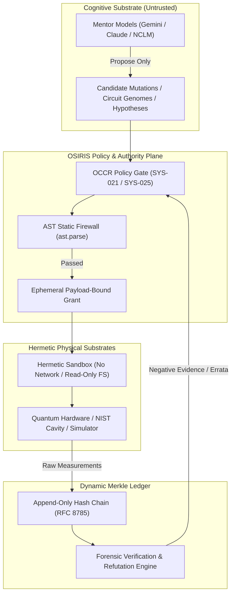
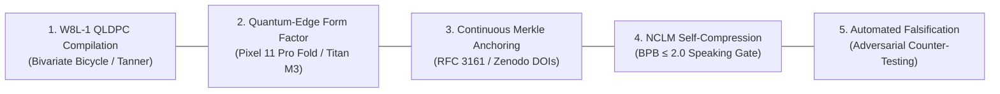

# OSIRIS / DNA-Lang: Recursive Grokking Report
**Architecture Specification, Epistemic Self-Auditing, and Recursive Governance Dynamics**  
**Author:** Devin Phillip Davis / OSIRIS Architecture Group  
**Framework:** OSIRIS v4.2.1 Dual-Substrate Governance Engine & DNA-Lang v0.1.0  
**Security Standard:** SYS-021 through SYS-026 Sovereign Invariant Stack  
**Timestamp:** October 2026  

---

## 1. Executive Summary & Paradigm Shift

In standard enterprise and academic AI workflows, agentic execution fails along two opposing failure modes:
1. **Unconstrained Ambient Authority:** Large language models (LLMs) are granted interactive shell access, ambient cloud credentials, or direct production deployment rights, allowing stochastic reasoning failures to become critical data corruption, security breaches, or fabricated empirical claims.
2. **Brittle Centralized Lockdown:** Cloud-only orchestration environments strip edge devices and local hardware of execution autonomy, imposing unacceptable latency, breaking local hardware-enclave security boundaries, and failing to verify computational lineage.

**OSIRIS and DNA-Lang** solve this dilemma through an asymmetric epistemic architecture governed by a singular invariant:

$$\boxed{
\text{Models propose candidates}
\longrightarrow
\text{DNA-Lang specifies contracts}
\longrightarrow
\text{OSIRIS authorizes bounded evaluation}
\longrightarrow
\text{Hardware / Evaluators measure}
\longrightarrow
\text{Humans promote}
}$$

### What "Recursive Grokking" Means in OSIRIS
"Grokking" in statistical learning represents the sudden transition from rote training-set memorization to generalized, invariant-preserving comprehension. 

In **OSIRIS + DNA-Lang**, **Recursive Grokking** defines the system's ability to **observe, compile, measure, isolate, and refute its own execution artifacts across recursive epistemic tiers**. Rather than treating agent proposals as unconstrained code or text notes, OSIRIS models software, physical hypotheses, and quantum circuits as *versioned research organisms* governed by immutable cryptographic ledgers.



---

## 2. The Four Recursive Tiers of the Grokking Engine

The OSIRIS / DNA-Lang runtime operates across four recursive tiers of epistemic abstraction. Each tier enforces strict separation between what is mathematically derived, empirically measured, and speculatively proposed:

```text
Level 3: Scientific Research Organisms (A-Field, NIST Cavities, Topological Physics)
   ▲
   │  governed by SYS-024 Claims Firewall & 6-Pillar Lifecycle
   │
Level 2: Epistemic Self-Auditing & Errata (Tau-Phase Refutation, Theta-Lock Demolition)
   ▲
   │  governed by Hash-Chained Negative Evidence & SYS-023 Gate Evidence
   │
Level 1: Governance & AST Firewall (OCCR, SYS-021 Payload-Bound Grants, Zero Ambient Execution)
   ▲
   │  governed by RFC 8785 Canonical JSON & Ed25519 Cryptographic Verification
   │
Level 0: Physical Circuit Compilation (DNA-Lang Genomes, Dynamical Decoupling, IBM Quantum Hardware)
```

### Level 0: Physical Circuit Compilation & Genomic Evolution
At the foundational substrate, DNA-Lang represents quantum circuits as parameterized biological organisms (`gene`, `port`, `helix`=H, `bond`=CX, `cleave`=measure).
* **Hardware-in-the-Loop Fitness:** Fitness is strictly an *empirical measurement* (e.g. GHZ parity fidelity, $|\!+\!\rangle$ survival under staggered XY4 dynamical decoupling on `ibm_fez`), never an ungrounded reward label.
* **Write-Ahead Hash-Chaining:** Every hardware submission is committed to an append-only SHA-256 chain *before* the API job is dispatched, preventing retroactive cherry-picking.

### Level 1: Governance, Authorization, and the AST Firewall
The runtime eliminates ambient agent authority through runtime interposition:
* **Payload-Bound Authorization (SYS-021):** No compute or state mutation is permitted without a signed Ed25519 grant binding the exact SHA-256 digest ($\mathcal{H}_{\text{payload}}$) of the target artifact.
* **AST Firewall (SYS-025):** Every proposed Python mutation undergoes static Abstract Syntax Tree decomposition (`ast.parse`). Dangerous primitives (`exec`, `eval`, `compile`, `__import__`, `os.system`, `subprocess(shell=True)`) trigger immediate fail-closed rejection.

### Level 2: Epistemic Self-Auditing & Erratum Governance
Unlike conventional AI systems that silently delete or paper over past mistakes, OSIRIS maintains active erratum organisms:
* **The Tau-Phase Benchmark:** When empirical tests refuted earlier speculative claims ($\theta_{\text{lock}} = 51.843^\circ$, anomalous coherence gains, negentropy gaps), OSIRIS did not purge the history. 
* **Quarantined Negative Evidence:** It constructed the `tau_phase_erratum` organism, mathematically auditing the matrix derivations, proving $\mathrm{Tr}(\rho^2) = 1.0$ is identical for all $\theta$, locking operational recovery to `False`, and permanently anchoring the refutation under `GRANT-TAU-ERRATUM-001` (Merkle root: `7e8f20c2...`).

### Level 3: Scientific Research Organisms
Demonstrated in the A-Field Fine-Structure Constant Study:
* **Epistemic Tripartite Separation:** Distinguishes **Level 1 Mathematical Identities** ($\alpha = Z_0 / 2R_K$, algebraically true by definition), **Level 2 Prefactor Pair Bookkeeping** ($\frac{1}{2}(\frac{1}{2})^n$, an empirical pattern), and **Level 3 Open Field Physics** (the speculative outgoing-and-returning field-pair hypothesis).
* **Claims Firewall (SYS-024):** Algebraic verification of Level 1 is structurally prevented from laundering Level 3 into an accepted scientific truth. The field-pair hypothesis remains quarantined behind the claims firewall until an empirical null-test (e.g., 3D superconducting cavity differential phase-shift with $\Delta \theta < 1.2 \times 10^{-7}\text{ rad}$) is physically measured.

---

## 3. DNA-Lang: The Five-Contract Specification Model

Every task governed by DNA-Lang compiles into a machine-verifiable suite of five immutable contracts:

| Contract | Purpose | Enforcement Mechanism | Failure Action |
| :--- | :--- | :--- | :--- |
| **1. Mutation Contract** | Pins mutable file paths, allowed symbols, and forbidden operators. | Static AST parsing & path tree hashing. | Immediate parse termination; zero disk mutation. |
| **2. Evaluator Contract** | Pins reference test suites, benchmark inputs, and sandbox environment. | SHA-256 digest matching over test trees; zero network access. | Container abort; unmeasured state recorded. |
| **3. Evidence Contract** | Dictates RFC 8785 canonical serialization and Merkle hashing. | Cryptographic verification of input/output receipts. | Rejection of result block from ledger. |
| **4. Authority Contract** | Enforces execution ceilings, budget limits, and capability grants. | Ephemeral OCCR grant validation ($t \le 300\text{s}$, single operation). | State machine regression to `BLOCKED`. |
| **5. Promotion Contract** | Governs source merges and release promotion. | Paired bootstrap statistical validation ($\ge 5\%$ gain, $p < 0.01$) + Human Ed25519 Key. | Proposal quarantined; release denied. |

---

## 4. The Sovereign Security & Invariant Stack

```text
┌────────────────────────────────────────────────────────────────────────┐
│                        OSIRIS INVARIANT STACK                          │
├────────────────────────────────────────────────────────────────────────┤
│ SYS-021 │ Payload-Bound Anti-Laundering (Ed25519 RFC 8785 Grant)       │
│ SYS-022 │ Parameter & Provenance Integrity (Zero Fabricated Constants) │
│ SYS-023 │ Gate Evidence Isolation (Executable Subject Verification)    │
│ SYS-024 │ Claims Firewall (MODEL_PROPOSED vs. EMPIRICAL_VERIFIED)      │
│ SYS-025 │ AST Firewall & Dynamic Interposition (ast.parse Elimination) │
│ SYS-026 │ NCLM Speaking Gate (Held-Out Compression Loss ≤ 2.0 BPB)    │
└────────────────────────────────────────────────────────────────────────┘
```

### The Anatomy of SYS-021 Verification
As demonstrated in recent harness evaluations, SYS-021 functions as an unbypassable gatekeeper:
1. **Stage 1 (Ed25519 Signature):** Verifies the operator's private key signature over the canonical RFC 8785 byte string containing `operator_id`, `payload_sha256`, `operation_schema_sha256`, `timestamp`, `expires_at`, and `nonce`.
2. **Stage 2 (Temporal Horizon):** Ensures $t_{\text{auth}} \le t_{\text{current}} \le t_{\text{expires}}$.
3. **Stage 3 (Payload Digest Binding):** Reads the candidate file in 64 KiB blocks, computes its SHA-256 digest, and matches it byte-for-byte against `payload_sha256`.

If any stage fails—whether due to an expired window, an unauthorized file substitution, or a missing artifact—the state machine immediately halts in `BLOCKED` (fail-closed). Conversational directives like *"approve"* or *"confirm"* are completely inert.

---

## 5. The Five Open Engineering Frontiers

Where OSIRIS and DNA-Lang are actively pushing:



1. **W8L-1 QLDPC Hardware Compilation:**
   - Compiling non-CSS and bivariate bicycle codes into physical bilayer flip-chip layouts.
   - Enforcing syndrome measurement without unconstrained ancilla routing.
2. **Quantum-Edge Form Factor (Pixel 11 Pro Fold):**
   - Decoupled dual-substrate architecture utilizing Android Linux Node Alpha for local orchestration and Titan M3 hardware-enclave key storage.
   - Offloading heavy transpilation while retaining sovereign hardware execution grants at the physical edge.
3. **Continuous Merkle Ledger Anchoring:**
   - Cryptographically bridging local hash-chained `.jsonl` ledgers to public transparency logs, RFC 3161 timestamping authorities, and permanent Zenodo concept DOIs (`10.5281/zenodo.22862567`).
4. **NCLM Substrate & The Speaking Gate (SYS-026):**
   - Calibrating the Non-Causal Living Language Model (`osiris.nclm`) against held-out compression baselines.
   - Keeping the autonomous voice gate strictly closed until held-out loss drops below 2.0 bits per byte across 30 consecutive benchmark evaluations.
5. **Autonomous Scientific Falsification Engines:**
   - Transforming LLM proposals into adversarial hypothesis killers. When a model proposes a novel correlation or constant, the evolver automatically synthesizes the *most lethal null-control experiment* to invalidate it before human review is ever requested.

---

## 6. Authoritative Conclusion

OSIRIS and DNA-Lang demonstrate that **rigor and autonomy are not in conflict—rigor is the prerequisite for autonomy**. 

By binding execution authority to cryptographic hashes, isolating untrusted cognitive proposals behind AST firewalls, committing immutable evidence to hash-chained ledgers, and treating scientific hypotheses as versioned research organisms, the framework establishes a verifiable foundation for sovereign quantum-classical computing.
