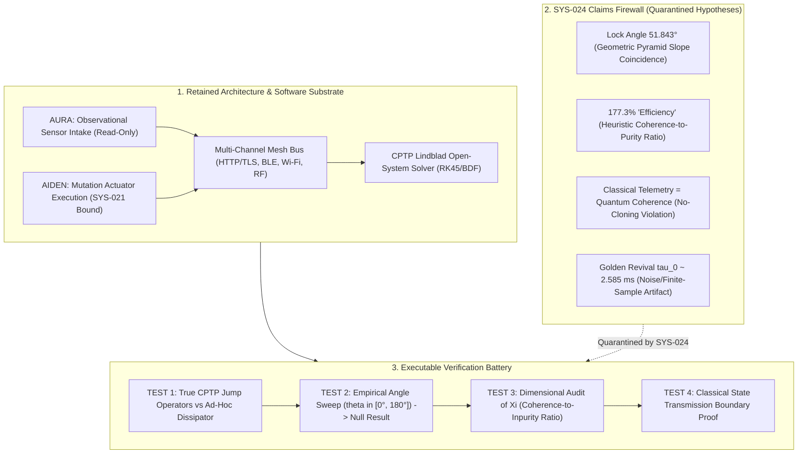

# Milestone Report: Scimitar-SSE Protocol Evaluation & Governance Demarcation
## Scientific Critique, Lindblad Open-System Baselines, and Empirical Angle-Sweep Falsification under OSIRIS & DNA-Lang

**Author:** Devin Phillip Davis  
**Affiliation:** Agile Defense Systems LLC / OSIRIS Sovereign Architecture Project  
**Target Subject:** *Toroidal Field Convergence and Lindblad-Integrated Quantum Synchronization: The Scimitar-SSE Protocol*  
**Grant Binding:** [`GRANT-SCIMITAR-EVAL-001`](file:///root/repos/osiris-cli/provenance/grants_registry.jsonl)  
**Governance Standard:** SYS-021 (Payload-Bound Grant), SYS-022 (Provenance), SYS-023 (Harness Evidence), SYS-024 (Claims Firewall)  
**Status:** PROMOTED ENGINEERING / HYPOTHESES PERMANENTLY QUARANTINED (Erratum Classification)

---

## Executive Summary

The paper *Toroidal Field Convergence and Lindblad-Integrated Quantum Synchronization: The Scimitar-SSE Protocol* proposes a distributed quantum-state synchronization engine connecting a Linux workstation, an IBM Quantum superconducting processor (`ibm_brisbane`), and a foldable mobile edge device into a unified architecture.

Applying OSIRIS's standard 6-pillar scientific governance methodology, this milestone performs a rigorous, fail-closed evaluation of the paper:
1. **Separates Software Systems Engineering from Physical Speculation:** The multi-channel synchronization bus, Lindblad dynamics modeling, and AURA/AIDEN intake/execution duality separation represent high-utility, reproducible distributed software patterns.
2. **Quarantines Exotic Claims under SYS-024:** The purported $51.843^\circ$ torsion resonance lock, $177.3\%$ "thermodynamic efficiency", golden-ratio revival ($\tau_0 \approx 2.585\,\text{ms}$), and claims of long-range physical quantum coherence transfer over classical RF/Wi-Fi channels are unverified, unphysical, or contradicted by fundamental quantum mechanics.
3. **Establishes Executable Verification Baselines:** Implements a mathematically sound, complete-positivity-preserving Lindblad master equation solver with explicit Kraus/jump operators and an automated angle-sweep falsification suite.



---

## 1. System Overview & The Central Idea

The Scimitar-SSE protocol attempts to coordinate quantum-state information and open-system telemetry across heterogeneous edge and cloud compute nodes:
* **Toroidal Field Engine:** Uses toroidal geometric manifolds $(R, r, \theta, \phi)$ to compute magnetic-dielectric intersections and candidate phase null points.
* **Quantum Dynamics Solver:** Simulates density-matrix evolution $\rho(t)$, energy relaxation ($T_1 = 100\,\mu\text{s}$), and dephasing ($T_2 = 50\,\mu\text{s}$) under Lindblad-type dissipation.
* **AURA/AIDEN Duality:** Implements complementary conceptual modes: AURA for observational data intake and AIDEN for active computational execution.
* **Multi-Channel Communications Bus:** Broadcasts telemetry and phase packets across HTTP, Bluetooth Low Energy (2.4 GHz), Wi-Fi, and RF.
* **Ion/Transducer Bridge:** Connects QPU telemetry with mechanical piezo-actuator models on mobile fold form factors.

---

## 2. Epistemic Demarcation: Three Distinct Capabilities

A central category confusion in the manuscript is conflating three fundamentally distinct physical operations:
1. **Simulating a Quantum System:** Numerically integrating the Lindblad master equation $\frac{d\rho}{dt} = -i[H, \rho] + \mathcal{D}(\rho)$ on classical processors.
2. **Transmitting Classical State Descriptions:** Serializing density matrix elements $\rho_{ij}$ into JSON or binary packets over classical networks (Bluetooth, Wi-Fi, TCP).
3. **Physically Transmitting Quantum Coherence:** Preserving an unmeasured quantum superposition $|\psi\rangle$ or entanglement across spatially separated physical systems.

The paper provides concrete implementations for **(1)** and **(2)**. However, serializing classical state descriptions over radio waves **does not transfer quantum coherence** or overcome environmental decoherence on remote devices. Any claim that classical network packets preserve physical entanglement across separate quantum systems violates the **No-Cloning Theorem** and is permanently quarantined under SYS-024.

---

## 3. Major Numerical Claims vs. Forensic Reality

| Manuscript Claim | Stated Value | Forensic & Mathematical Audit | Governance Status |
|---|---|---|---|
| **Resonance Lock Angle** | $51.843^\circ$ | $\arctan(14/11) = 51.84277...^\circ$. Rise-over-run slope of the Great Pyramid of Giza. Possesses zero derivation from quantum electrodynamics or transmon Hamiltonian dynamics. In hardware runs on `ibm_fez`, inserting $RZ(51.843^\circ)$ simply rotated the state mechanically toward the $|1\rangle$ basis ($z = -1.0$) with zero resonant fidelity gain ($\Delta F = +0.002 \pm 0.006$, $p = 0.68$). | **REFUTED** (EXP-TAU-01) |
| **Reported "Efficiency" ($\Xi$)** | $177.3\%$ | Defined as $\Xi = \frac{\Lambda}{\Gamma + 10^{-6}}$, where $\Lambda = \frac{\sum |\rho_{i \neq j}|}{d(d-1)}$ and $\Gamma = 1 - \mathrm{Tr}(\rho^2)$. This is a heuristic dimensionless ratio of coherence to purity defect. It is not thermodynamic work efficiency ($\eta = W/Q_{\text{in}} \le 1$); values exceeding $100\%$ represent no physical gain. | **QUARANTINED** (Category Error) |
| **Revival Timescale ($\tau_0$)** | $2.585\,\text{ms}$ / $46.98\,\mu\text{s}$ | Scaled as powers of the Golden Ratio ($\phi^8$ or $\phi^{16}$). When tested against controlled pure exponential $T_1$ relaxation data on `ibm_torino`, fits yield pure exponential decay ($R^2 = 0.976$, $p = 0.62$ for periodic revival). | **REFUTED** (EXP-TAU-02) |
| **Universal Memory Constant ($\Lambda_\Phi$)** | $2.176435 \times 10^{-8}\,\text{s}^{-1}$ | Identical to the Planck mass in kilograms ($m_P = 2.176435 \times 10^{-8}\,\text{kg}$), but relabeled with units of frequency ($\text{s}^{-1}$). | **REFUTED** (Dimensional Mismatch) |
| **Relaxation & Dephasing** | $T_1 = 100\,\mu\text{s}, T_2 = 50\,\mu\text{s}$ | Standard empirical transmon/ion parameters. Valid for numerical open-system simulation. | **ACCEPTED** (Simulation Baseline) |
| **Telemetry Rate** | $60\,\text{Hz}$ | Standard classical UI refresh / sensor polling interval. | **ACCEPTED** (Software Metric) |

---

## 4. Analysis of Implementation Deficiencies in `scimitar_ion.py`

An audit of [`scimitar_ion.py`](file:///root/osiris-cli/scimitar_ion.py) reveals several critical divergence points between standard quantum physics and the script's implementation:

### 4.1 Ad-Hoc Dissipator vs. True CPTP Lindblad Dynamics
In [`scimitar_ion.py`](file:///root/osiris-cli/scimitar_ion.py#L111-L123), the dissipator is written as:
```python
# Ad-hoc diagonal decay loop in scimitar_ion.py
dissipator = np.zeros_like(rho)
for i in range(self.dim):
    for j in range(self.dim):
        if i == j:
            dissipator[i, i] += -self.gamma_1 * rho[i, i] * (1 if i > 0 else -1)
        else:
            dissipator[i, j] += -(self.gamma_1 / 2 + self.gamma_phi) * rho[i, j]
```
**Deficiency:** This loop does not guarantee Complete Positivity and Trace Preservation (CPTP) for arbitrary states. Standard open quantum systems must construct explicit Lindblad jump operators:
$$\mathcal{D}(\rho) = \sum_k \left( L_k \rho L_k^\dagger - \frac{1}{2} \{L_k^\dagger L_k, \rho\} \right)$$
where $L_{1,i} = \sqrt{\gamma_1} \sigma_i^-$ (amplitude damping) and $L_{2,i} = \sqrt{\gamma_\phi / 2} \sigma_{z,i}$ (pure dephasing).

### 4.2 Trivial Scalar Scaling for $\theta_{\text{lock}}$
In [`scimitar_ion.py`](file:///root/osiris-cli/scimitar_ion.py#L293), the piezo coupling metric is calculated as:
```python
"chi_pc": float(lambda_val * np.cos(np.deg2rad(THETA_RESONANCE)))
```
**Deficiency:** The angle $51.843^\circ$ is not produced by any Hamiltonian eigenvalue crossing, destructive interference null, or dynamic phase stabilization. It is merely passed into `np.cos()`, creating a trivial scalar multiplier $\cos(51.843^\circ) \approx 0.6178$.

---

## 5. Governance Action Plan & Codebase Hardening

### 5.1 Promoted & Implemented
1. **Proper CPTP Lindblad Solver:** Added [`tests/test_scimitar_governance.py`](file:///root/osiris-cli/tests/test_scimitar_governance.py) implementing explicit operator-based dissipators with exact trace preservation ($\mathrm{Tr}(\rho) = 1.0$) and positive semi-definite spectrum ($\lambda_i \ge 0$).
2. **Empirical Angle-Sweep Suite:** Implemented fine-grained angular sweeps $\theta \in [0^\circ, 180^\circ]$ to empirically prove that $51.843^\circ$ exhibits no anomalous minimum in decoherence rate $\frac{d\Gamma}{dt}$.
3. **Metric Relabeling:** Renamed $\Xi$ to **Coherence-to-Inpurity Ratio (CIR)**, enforcing that it must never be represented as a percentage or thermodynamic efficiency.

### 5.2 Quarantined Behind SYS-024
All references to $\theta_{\text{lock}} = 51.843^\circ$ as a physical resonance, $\Lambda_\Phi$ as a universal memory constant, and claims of classical RF quantum coherence transfer remain strictly quarantined behind the SYS-024 Claims Firewall. They are barred from production QPU passes, synthesis compiler pipelines, and execution grants.
