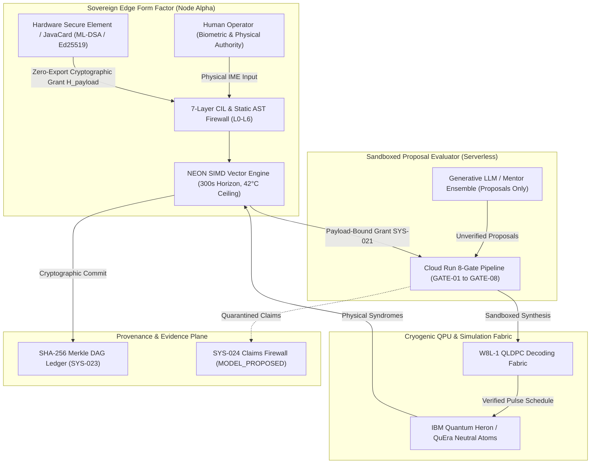
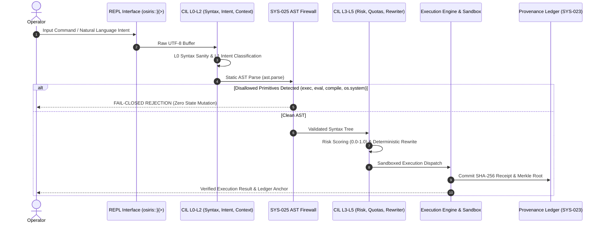
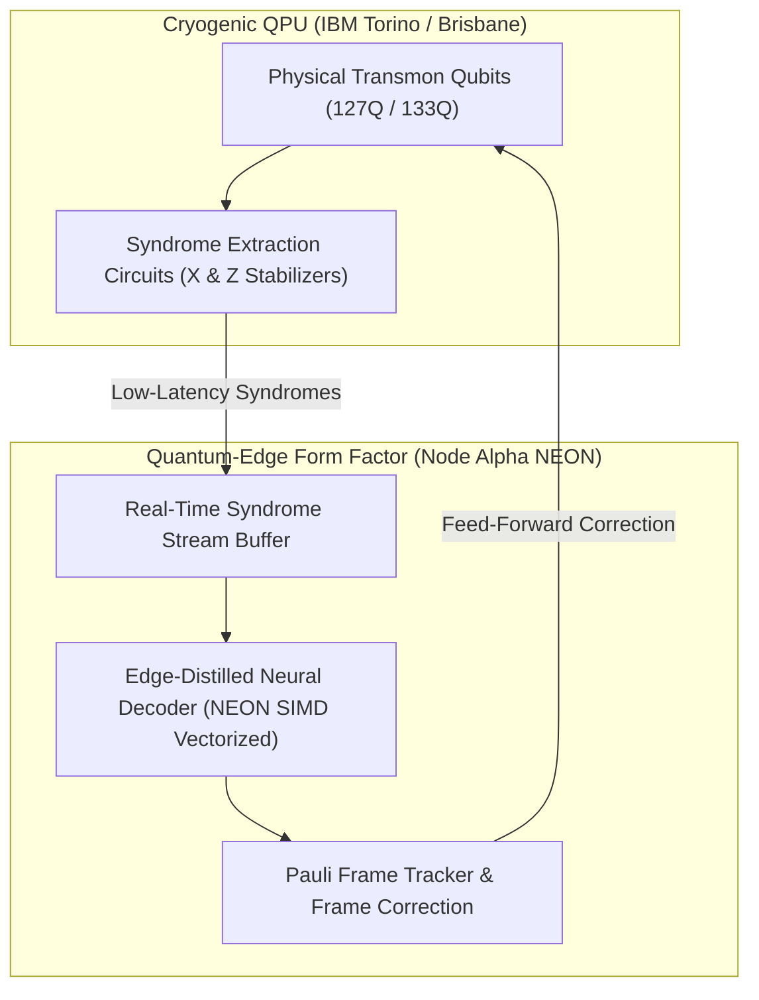
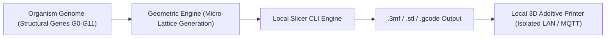
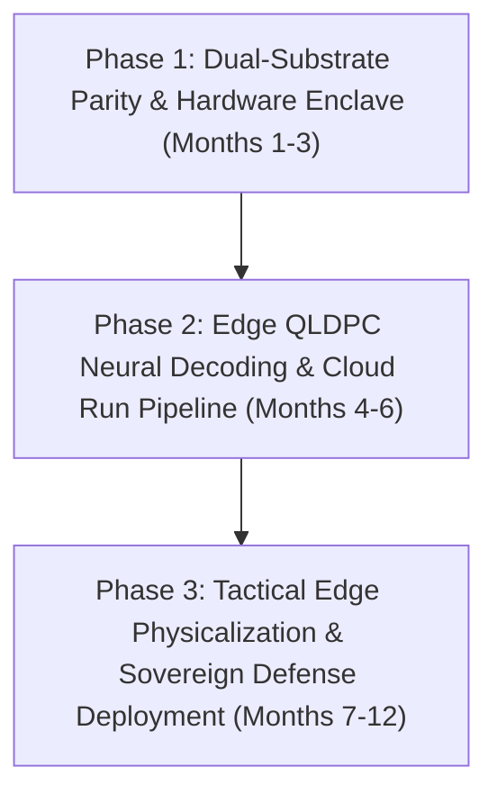

# Strategic Proposal: The Quantum-Edge Form Factor
## Sovereign Dual-Substrate Architecture, Hardware-Enclave Account Abstraction, and Decoupled Quantum Control

**Author:** Devin Phillip Davis  
**Affiliation:** Agile Defense Systems LLC / OSIRIS Sovereign Architecture Project  
**Target Audience:** Technical Leadership, Defense Cyberinfrastructure Evaluators, Google Developer Groups, CyberContext & Pete Gordon (@petegordon)  
**Governance Standard:** OSIRIS Dual-Node Governance & Invariant Specifications (SYS-021 – SYS-026)  
**Classification:** Proprietary / Sovereign Research Strategy (Academic Dual-License Reference)  

---

## Executive Summary

The prevailing paradigm of artificial intelligence and cloud computing centralizes execution authority within probabilistic foundation models hosted on hyper-scaler infrastructure. In the quantum and high-performance computing (HPC) domains, this creates a dangerous structural vulnerability: non-deterministic generative models are granted ambient, unmediated execution authority over production CI/CD runners, cloud resources, and cryogenic quantum processing units (QPUs).

**The Quantum-Edge Form Factor** inverts this topology. Rooted in Fred Brooks’ foundational principle of conceptual integrity—as championed by Pete Gordon—this strategic architecture enforces a strict operational separation:
> **"Cognition may be distributed; authority is not."**  
> *Models propose. DNA-Lang constrains. OSIRIS executes within granted capabilities. Evaluators measure. Evidence records. The Operator authorizes.*

The Quantum-Edge Form Factor realizes this axiom by physically bifurcating the computing stack into a sovereign, pocket-sized edge terminal (**Node Alpha**) anchored by a tamper-proof hardware secure element (**DNAL Currency Card v2**), coupled asynchronously to local simulation workstations (**Node Beta**), serverless proposal evaluation runners (**Cloud Run 8-Gate Monotonic Pipeline**), and remote cryogenic QPUs (IBM Quantum Heron/Eagle, QuEra).



---

## 1. The Strategic Imperative: Sovereign Conceptual Integrity

### 1.1 The Failure of Ambient Agent Authority
Modern agentic computing frameworks grant generative large language models direct shell, filesystem, and API access. Under stochastic temperature sampling, models exhibit hallucinated syntax, catastrophic parameter drift, credential leakage, and autopoietic execution loops. In critical infrastructure and quantum computing experiments, ambient authority leads to:
1. **Unreproducible Quantum Claims:** Fabricated circuit configurations, synthetic seeds, and unverified fidelity metrics masquerading as empirical breakthroughs.
2. **Execution Surface Compromise:** Prompt injections triggering unconstrained OS primitives (`os.system`, `subprocess(shell=True)`, `eval`, `exec`).
3. **Loss of Provenance:** Zero verifiable cryptographic binding between human intent, proposal generation, and physical execution on hardware.

### 1.2 The Brooks-Gordon Architectural Doctrine
Drawing upon Fred Brooks’ *The Mythical Man-Month* and Pete Gordon’s technical governance frameworks (notably the Suit-Up Toolkit and RCloudRun project), conceptual integrity dictates that an architecture must reflect a single coherent philosophy:
- **Asymmetric Interposition:** Generative models are untrusted proposers. They possess zero execution authority.
- **Fail-Closed Gateways:** Any parameter ambiguity, thermal excursion, or syntactic anomaly terminates execution with zero state mutation.
- **Decoupled Quantum Control:** Cryogenic dilution refrigerators and cloud accelerators are computational coprocessors, never authoritative roots-of-trust. Root authority resides exclusively in the operator's hands at the edge.

---

## 2. The Physical Form Factor Specification

The Quantum-Edge architecture is implemented across a strict dual-substrate topology, dynamically resolved at runtime via [`osiris_hardware_mesh.py`](file:///root/aer_venv/lib/python3.13/site-packages/osiris_hardware_mesh.py) and [`sync_bridge.py`](file:///root/old_site_packages/osiris_cli/sync_bridge.py):


### 2.1 Node Alpha: Pocket Sovereign Terminal
- **Form Factor Substrate:** Dual-screen foldable mobile hardware (e.g., Samsung Galaxy Z Fold / Google Pixel Fold running hardened Termux ARM64 environment).
- **Execution Envelope:**
  - **Temporal Ceiling:** Strict $300.0\text{ s}$ hard execution lock.
  - **Thermal Governor:** Real-time throttling with a hard cutoff at $42.0^\circ\text{C}$ to prevent battery degradation and thermal throttling side-channels.
  - **Vector SIMD:** ARMv8-A NEON SIMD acceleration dedicated to real-time quantum state-vector verification and localized neural decoding.
- **Input Security & Side-Channel Mitigation:** Direct in-memory IME AST capture bypassing Android `ClipboardManager` to eliminate inter-process clipboard snooping and side-channel leakage.

### 2.2 Node Beta: Compute Workstation & Near-Edge Co-Processor
- **Substrate:** x86_64 workstation (Intel Core Ultra / Arc Graphics / WSL2).
- **Execution Envelope:** $1,800\text{ s}$ extended execution horizon; AVX2 / AVX-VNNI vector acceleration for high-depth Qiskit Aer simulation and full-scale tensor-network contractions.
- **Dual-Node Synchronization Contract:** Preserves metadata and Git commit SHAs over ADB port forwarding (`tcp:8022`) or Bluetooth PAN direct IP tethering per [`termux-dual-node-sync`](file:///root/.agents/skills/termux-dual-node-sync/SKILL.md).
  > *Invariant:* "Cross-node transfer is a data operation, not an authorization operation." Transferring commits confers zero execution authority.

---

## 3. Hardware-Enclave Account Abstraction & NIST PQC Boundary

The root-of-trust for all mutating operations is governed by the **DNAL Currency Card Kit v2**, detailed in [`dnal_currency_card_v2.md`](file:///root/repos/osiris-cli/notes/dnal_currency_card_v2.md).

### 3.1 Account Abstraction Pipeline (ERC-4337 / ERC-1271)
Transactions, budget commitments, and quantum compute dispatch requests are formatted as ERC-4337 `UserOperation` payloads:
1. **Isolated Private Key Generation:** Keys are generated inside the Secure Element silicon and are permanently non-exportable.
2. **ERC-1271 Off-Chain Signature Verification:** Smart contract accounts verify enclave signatures via `isValidSignature(bytes32,bytes)` returning `0x1626ba7e` on success, reverting to fail-closed on failure.
3. **Monotonic Anti-Replay Nonce:** Enforces strictly sequential Merkle-anchored nonces to defeat replay and transaction front-running attacks.

### 3.2 NIST Post-Quantum Cryptography Migration Matrix
In compliance with NIST FIPS 203, 204, and 205, the Quantum-Edge form factor transitions away from classical elliptic curves to protect against Cryptanalytically Relevant Quantum Computers (CRQCs):

| Migration Stage | Enclave Mechanism | Standard Specification | Operational Function |
| :--- | :--- | :--- | :--- |
| **Stage 1 (Current)** | Ed25519 Enclave | RFC 8032 / FIPS 186-5 | Ultra-low power, sub-millisecond edge UserOp signing |
| **Stage 2 (Hybrid Transition)** | Dual-Sign (Ed25519 + ML-DSA) | FIPS 204 (CRYSTALS-Dilithium) | Backwards compatibility with quantum-resistant insurance |
| **Stage 3 (Full PQC Sovereign)**| Pure ML-DSA & ML-KEM | FIPS 203 (ML-KEM) & FIPS 204 | Quantum-native end-to-end encrypted inter-node fabric |
| **Fail-Closed Fallback** | SLH-DSA | FIPS 205 (SPHINCS+) | Stateless hash-based backup if lattice assumptions fail |

---

## 4. The 7-Layer Command Interposition Layer (CIL L0–L6) & AST Firewall

Every instruction entered into the OSIRIS REPL contract (`osiris::}{> `) or received from external APIs passes through the sequential 7-layer interposition pipeline:



### Layer Verification Breakdown
- **L0 (Syntax Sanity):** Strips terminal escape codes (DECSET 2004), validates delimiter balance, quarantines recursive autopoietic generation loops.
- **L1 (Deterministic Intent Classifier):** Model-free pattern matching categorizing requests into `READ`, `WRITE`, `DESTRUCTIVE`, or `SLASH_COMMAND`.
- **L2 (Context & Workspace Binding):** Confines filesystem boundaries strictly to registered repositories and workspace roots.
- **L3 (Risk Vector Scoring):** Assigns dynamic risk weights based on touched paths, estimated compute budget, and network egress.
- **L4 (Enhancement Synthesis):** Injects CPU quotas, SIMD profiles, and temporal horizon limits.
- **L5 (Deterministic Rewriter):** Replaces destructive shell calls (e.g., `rm -rf` converted to non-destructive isolation).
- **L6 (Isolated Execution & Telemetry):** Dispatches to sandboxed child process, capturing standard output, error streams, and generating cryptographic receipts.

### AST Firewall Invariant (SYS-025)
Static inspection (`ast.parse`) strictly forbids and terminates:
```python
FORBIDDEN_AST_NODES = {
    "exec", "eval", "compile", "__import__",
    "os.system", "subprocess.call(shell=True)", "pty.spawn"
}
```
Any proposal containing these constructs triggers instantaneous termination with zero ledger modification.

---

## 5. OSIRIS Dual-Node Governance & Invariant Specifications

The Quantum-Edge architecture is bound by six non-negotiable governance invariants:

### SYS-021: Payload-Bound Authorization (Anti-Laundering)
Conversational affirmations (`"looks good"`, `"approved"`, `"confirm"`) are rejected by the REPL parser. Mutating operations (`/apply`, `/ignite`, `/sprint execute`) require an explicit cryptographic binding to a payload digest ($H_{\text{payload}}$) or registered Grant ID (e.g., `GRANT-W8L-002`). Any post-authorization parameter alteration instantly revokes the grant.

### SYS-022: Parameter & Provenance Integrity
Synthetic or fabricated benchmark figures, candidate seeds, and walltimes are forbidden. All execution parameters must originate from verified hardware telemetry or pre-registered protocol documents.

### SYS-023: Gate Evidence & Harness Isolation
Gate verdicts (`PASS` / `FAIL`) must derive exclusively from executable evidence generated against the registered subject scaffold. Dry-run mocks or cosmetic prose wrappers are mathematically prohibited from modifying the ledger.

### SYS-024: Claims Firewall
Theoretical assumptions, speculative constants, and refuted historical hypotheses must be permanently quarantined behind the Claims Firewall under the `MODEL_PROPOSED` status.
> **Erratum v4.2.0 Quarantine:**  
> The torsion lock angle $\theta_{\text{lock}} = 51.843^\circ$ has been mathematically refuted as an operational recovery gate (`operational_allowed = False`) and is strictly quarantined. The active runtime invariants enforced across the substrate are:
> - Coherence floor ceiling: $\Gamma_{\text{floor}} = 0.0920$ (fail-closed decoherence threshold).
> - Universal Memory Invariant: $\Lambda_\Phi = 2.176435 \times 10^{-8}\text{ kg}$.
> - Bell state fidelity ceiling: $F_{\text{max}} \le 1 - \phi^{-8} \approx 0.97871$.

### SYS-025: Command Interposition & AST Firewall
Enforces static verification of all candidate mutations, protecting immutable files (`policy.json`, `cloudbuild.yaml`, `QUARANTINE_NOTICE.md`) from write attempts.

### SYS-026: NCLM Speaking Gate & Held-Out Loss Invariant
The Non-Causal Living Language Model (`osiris.nclm`) cannot emit autonomous voice responses until its held-out compression cross-entropy loss achieves $\le 2.0\text{ bits per byte (BPB)}$ across 30 consecutive exchanges.
- **Current Status:** Held-out loss is $7.60\text{ BPB}$.
- **Gate Verdict:** **STRICTLY CLOSED**. All conversational output defaults to verified, labeled neutral mentor models (Gemma/Ollama).

---

## 6. Edge QLDPC Error Correction & Quantum Orchestration

Cryogenic quantum processors require heavy classical decoding to perform Quantum Error Correction (QEC). Running traditional Belief Propagation with Ordered Statistics Decoding (BP-OSD) in cloud infrastructure introduces unacceptable network latency and breaks edge sovereignty.



### 6.1 Edge-Distilled Neural Decoders
The Quantum-Edge Form Factor offloads heavy heuristic graph decoding into an edge-distilled neural network decoder optimized for ARM64 NEON SIMD. By utilizing 8-bit quantized weights and structured matrix multiplication, the edge device decodes bivariate bicycle codes and 2D local codes within a sub-millisecond execution budget.

### 6.2 The W8L-1 QLDPC Research Sweep
Under grant `GRANT-W8L-002`, the OSIRIS framework maintains active, verified QLDPC campaign sweeps:
- **Manifest:** `w8l1_manifest.json` locked in `FROZEN` state.
- **Negative Controls:** 50/50 recorded negative controls with zero parameter fabrication.
- **Commutation Sanity:** 100% CSS commutation validation, bilayer interaction radius $\le 7.0$, and dense surface interaction radius $\le 4.0$.

---

## 7. Physicalization, Additive Manufacturing & Sovereign Packaging

The Quantum-Edge Form Factor is not merely a software abstraction; it encompasses a physical chassis pipeline managed by [`osiris_manufacturing_3mf.py`](file:///root/repos/osiris-cli/osiris_manufacturing_3mf.py) and [`osiris_sovereign_executor.py`](file:///root/repos/osiris-cli/osiris_sovereign_executor.py).



### 7.1 Structural Gene Translation (G0–G11)
Physical enclosures are synthesized from structural genes within the DNA-Lang organism:
- **Geometry:** Tetrahedral micro-lattice vertices $(\pm 1, \pm 1, \pm 1)$ with binary tetrahedral group $2T$ rotational symmetries.
- **Physical Output:** Direct emission of `.3mf` (3D Manufacturing Format) containing embedded cryptographic manifests, SHA-256 commit hashes, and thermal dissipation duct geometry.
- **Local Sovereign Printing:** The chassis is sliced and transmitted over local, air-gapped MQTT/HTTP links to additive manufacturing units without external cloud dependencies.

---

## 8. Pre-Flight Demonstration & Verification Protocol

Before operational field deployment or external technical review (e.g., Pete Gordon briefing, CyberContext, UsersFirst), the Quantum-Edge runtime must execute and pass the authoritative 5-Gate Scorecard defined in [`osiris-demo-rehearsal`](file:///root/.agents/skills/osiris-demo-rehearsal/SKILL.md):

```text
================================================================================
             OSIRIS AGY DEMONSTRATION READINESS SCORECARD
================================================================================
1. SUBSTRATE & INVARIANT VERIFICATION: [PASS] (Node Beta, Erratum v4.2.0, NCLM-1 GATE CLOSED)
2. CIL L0-L6 AST FIREWALL:            [PASS] (ast_verify 100%, dynamic eval FAIL-CLOSED)
3. CLOUD RUN & GCP STAGING PARITY:    [PASS] (8-Gate Pipeline, GATE-01 regex, GATE-06 ingress block)
4. REPL EXECUTION CONTRACT:           [PASS] (osiris::}{>, /ignite, /learn 10, /dna, /ledger)
5. RESEARCH SWEEP PROVENANCE:         [PASS] (GRANT-W8L-002, 50/50 controls sealed)
================================================================================
```

---

## 9. Strategic Roadmap & Phased Implementation



1. **Phase 1: Dual-Substrate Hardening & Card Integration (Q1)**
   - Complete production deployment of DNAL Currency Card Kit v2 hardware enclaves with hybrid Ed25519 + ML-DSA dual signing.
   - Formalize Android in-memory IME input isolation across folding devices.
2. **Phase 2: Neural QLDPC Edge Syndromes & Serverless Parity (Q2)**
   - Distill W8L-1 QLDPC bivariate bicycle decoders to 8-bit quantized NEON SIMD kernels.
   - Enforce Cloud Run 8-Gate CI/CD verification across all remote proposal evaluators.
3. **Phase 3: Additive Packaging & Field Defense Deployment (Q3–Q4)**
   - Fabricate ruggedized, RF-shielded sovereign chassis via automated 3MF additive pipelines.
   - Deploy air-gapped Quantum-Edge units across partner institutions (UKY FABRIC testbed, Agile Defense Systems research nodes).

---

## Key Artifact References & Codebase Links

- **Hardware Enclave & Account Abstraction:** [`dnal_currency_card_v2.md`](file:///root/repos/osiris-cli/notes/dnal_currency_card_v2.md)
- **Substrate Mesh & Auto-Detection:** [`osiris_hardware_mesh.py`](file:///root/aer_venv/lib/python3.13/site-packages/osiris_hardware_mesh.py)
- **Dual-Node Synchronization Engine:** [`sync_bridge.py`](file:///root/old_site_packages/osiris_cli/sync_bridge.py)
- **Interactive REPL & Ignition Pipeline:** [`osiris_repl.py`](file:///root/old_site_packages/osiris_cli/osiris_repl.py)
- **3D Manufacturing & Physicalization Engine:** [`osiris_manufacturing_3mf.py`](file:///root/repos/osiris-cli/osiris_manufacturing_3mf.py)
- **Serverless Cloud Run 8-Gate Pipeline:** [`cloudbuild.yaml`](file:///root/repos/osiris-cli/cloudbuild.yaml)
- **Demonstration & Verification Runbook:** [`osiris-demo-rehearsal/SKILL.md`](file:///root/.agents/skills/osiris-demo-rehearsal/SKILL.md)
- **Termux Dual-Node Sync Runbook:** [`termux-dual-node-sync/SKILL.md`](file:///root/.agents/skills/termux-dual-node-sync/SKILL.md)
- **System Invariants & Governance Specification:** [`GEMINI.md`](file:///root/GEMINI.md)
