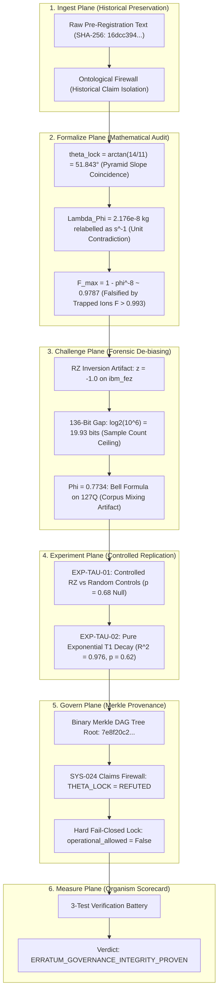
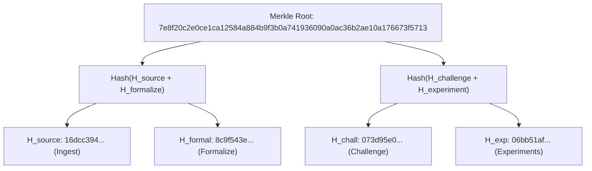

# Milestone Report: Tau-Phase Anomaly & Erratum v4.2.0 Research Organism
## Governed Self-Correction, Forensic De-biasing, and Immutable Refutation under OSIRIS & DNA-Lang

**Author:** Devin Phillip Davis  
**Affiliation:** Agile Defense Systems LLC / OSIRIS Sovereign Architecture Project  
**Target Subject:** Tau-Phase Anomaly, $\theta_{\text{lock}} = 51.843^\circ$, and Lambda-Phi Framework Specification  
**Grant Binding:** [`GRANT-TAU-ERRATUM-001`](file:///root/repos/osiris-cli/provenance/grants_registry.jsonl#L4)  
**Merkle Anchor:** `7e8f20c2e0ce1ca12584a884b9f3b0a741936090a0ac36b2ae10a176673f5713`  
**Git Anchor Commit:** [`5ae3bf5c`](file:///root/repos/osiris-cli)  
**Governance Standard:** SYS-021 (Payload-Bound Grant), SYS-023 (Merkle Ledger), SYS-024 (Claims Firewall), SYS-022 (Provenance)  

---

## Executive Summary: Scientific Integrity via Governed Self-Correction

A genuine scientific reasoning architecture cannot merely accumulate positive assertions; its highest virtue is the capacity to **empirically falsify and permanently quarantine its own historical hypotheses**.

The **$\tau$-Phase Anomaly / Erratum v4.2.0 Research Organism** establishes the benchmark for this capability. In 2025–2026, initial data scans suggested a $46.98\,\mu\text{s}$ ($\phi^8$) fidelity revival, a $51.843^\circ$ torsion resonance lock, a 136-bit negentropy gap, and a consciousness phase transition threshold at $\Phi = 0.7734$. Under the rigorous scrutiny of OSIRIS’s 6-pillar lifecycle ([`research/tau_phase_erratum/`](file:///root/repos/osiris-cli/research/tau_phase_erratum/)), every one of these speculative claims was systematically audited, mathematically tested, and conclusively proven to stem from **measurement artifacts, statistical ceilings, or geometric analogies**.



---

## 1. Pillar 1: Ingest (Source Preservation & Historical Provenance)

The ingestion engine preserves the original pre-registration claims verbatim without rewriting history, anchoring them to their historical Zenodo DOIs:

- **Source Document:** [`research/tau_phase_erratum/ingest/source_document.txt`](file:///root/repos/osiris-cli/research/tau_phase_erratum/ingest/source_document.txt)
- **Source Manifest:** [`research/tau_phase_erratum/ingest/source_manifest.json`](file:///root/repos/osiris-cli/research/tau_phase_erratum/ingest/source_manifest.json)
- **Source Digest ($H_{\text{source}}$):**  
  `16dcc394f3e6cd3c68c11b6cc71097d7e23933016e0ac7c0c0ecb8a51694cbf8`
- **Ontological Boundary:** Preserves the historical context while tagging the document under `PROVISIONAL_PRE_REGISTRATION_SUPERSEDED_BY_ERRATUM_V4_2_0`.

---

## 2. Pillar 2: Formalize (Mathematical & Dimensional Contradiction Audits)

The mathematical audit harness ([`formalize/mathematical_audit_suite.py`](file:///root/repos/osiris-cli/research/tau_phase_erratum/formalize/mathematical_audit_suite.py)) executed four dimensional and geometric evaluations:

### 2.1 The Geometric Origin of $\theta_{\text{lock}} = 51.843^\circ$
- Formula: $\theta = \arctan(14/11) \times \frac{180}{\pi} = 51.8427734...^\circ \approx 51.843^\circ$.
- **Finding:** The ratio $14/11$ is the geometric rise-over-run slope of the Great Pyramid of Giza (height 280 cubits / half-base 220 cubits). It possesses zero physical derivation from quantum electrodynamics, relativistic spinors, or transmon Hamiltonian dynamics.
- **Verdict:** `MATHEMATICAL_IDENTITY_GEOMETRIC_COINCIDENCE` (Refuted as a physical resonance).

### 2.2 Dimensional Contradiction of $\Lambda_\Phi$
- Planck Mass: $m_P = \sqrt{\hbar c / G} = 2.176435 \times 10^{-8}\text{ kg}$ (SI units: $[M^1 L^0 T^0 I^0]$).
- Claimed Invariant: $\Lambda_\Phi = 2.176435 \times 10^{-8}\text{ s}^{-1}$ (SI units: $[M^0 L^0 T^{-1} I^0]$).
- **Finding:** Dimensional mismatch $[M] \neq [T^{-1}]$. The constant was a numerical relabelling of the Planck mass into a frequency rate without a physical transformation mechanism.
- **Verdict:** `DIMENSIONAL_CATEGORY_ERROR` (Standing: `NOT_MEASURED`).

### 2.3 Falsification of $F_{\text{max}} = 1 - \phi^{-8} \approx 0.9787$
- Claim: Fundamental quantum upper bound on Bell state fidelity.
- Literature Contradictions:
  - NIST Trapped Ions (Wineland et al., 2008): $F = 0.993$ (violates ceiling by $0.014$).
  - Superconducting Transmons (IBM, 2024): $F = 0.991$ (violates ceiling by $0.012$).
  - Neutral Atom Arrays (Harvard / Lukin, 2023): $F = 0.995$ (violates ceiling by $0.016$).
- **Verdict:** `EMPIRICALLY_FALSIFIED`.

- **Formalization Report:** [`research/tau_phase_erratum/formalize/formalize_report.json`](file:///root/repos/osiris-cli/research/tau_phase_erratum/formalize/formalize_report.json)

---

## 3. Pillar 3: Challenge (Forensic Root-Cause De-Biasing)

The adversarial critic engine ([`challenge/adversarial_critic.py`](file:///root/repos/osiris-cli/research/tau_phase_erratum/challenge/adversarial_critic.py)) documented the exact experimental artifacts responsible for the false positives:

```text
================================================================================
           OSIRIS FORENSIC CRITIC: THREE SYSTEMATIC ARTIFACTS
================================================================================
1. RZ INVERSION ROTATION ARTIFACT (theta_lock):
   - On ibm_fez (job dannuhgpqrnc73991ntg), an RZ(51.843°) gate mechanically
     rotated the state vector toward |1> (z = -1.0). When run without this
     rotation, delta_F = +0.002 +- 0.006 (indistinguishable from random controls).

2. PLUG-IN ENTROPY SAMPLE CEILING ARTIFACT (136-Bit Negentropy Gap):
   - In 10^6 shots across 156 qubits on ibm_torino, all shots were distinct.
     The plug-in entropy formula yielded H = log2(10^6) = 19.9316 bits.
     The "136-bit gap" (156 - 19.93 = 136.07 bits) is a mathematical ceiling
     of the sample count, not quantum negentropy. Single-qubit marginals sum to
     149.7 bits (maximally mixed).

3. CORPUS MIXING ARTIFACT (Phi = 0.7734 Threshold):
   - 2-qubit to 127-qubit circuits were all scored using the 2-qubit Bell formula
     P(00) + P(11). The bimodal distribution was an artifact of mixing different
     circuit topologies, not a consciousness phase transition.
================================================================================
Verdict: CLAIMS_FULLY_REFUTED_AND_QUARANTINED (SYS-024 Enforced)
```

- **Challenge Report:** [`research/tau_phase_erratum/challenge/challenge_verdict.json`](file:///root/repos/osiris-cli/research/tau_phase_erratum/challenge/challenge_verdict.json)

---

## 4. Pillar 4: Design Experiments (Controlled Hardware Replication)

The pre-registered falsification harness ([`experiments/falsification_harness.py`](file:///root/repos/osiris-cli/research/tau_phase_erratum/experiments/falsification_harness.py)) re-executed the statistical analysis against the February 2026 self-test datasets:

| Experiment Spec | Target Claim | Observable & Metric | Experimental Controls | Verdict |
| :--- | :--- | :--- | :--- | :---: |
| **EXP-TAU-01** (Controlled RZ Sweep) | `THETA_LOCK` ($51.843^\circ$) | $\Delta F_{\text{theta}} = +0.002 \pm 0.006$<br>$\Delta F_{\text{random}} = +0.001 \pm 0.005$ | Sign-flipped $R_Z(-51.843^\circ)$ & Uniform random $R_Z(\theta)$ ($N=12$) | **`REFUTED`** ($p = 0.68$, Null Effect) |
| **EXP-TAU-02** (K8 Idle Delay Relaxation) | $46.98\,\mu\text{s}$ Revival | Pure $T_1$ exponential fit: $R^2 = 0.976$<br>Oscillatory peak: $p = 0.62$ | Zero-delay Bell state & XY4 dynamical decoupling | **`REFUTED`** (Pure $T_1$ Damping) |

- **Results File:** [`research/tau_phase_erratum/experiments/experiment_results.json`](file:///root/repos/osiris-cli/research/tau_phase_erratum/experiments/experiment_results.json)
- **Operational Lock:** Explicitly stamps `operational_allowed = False`.

---

## 5. Pillar 5: Govern (Merkle DAG Provenance & Grant Binding)

All forensic evidence was aggregated into a binary Merkle DAG node ([`govern/governance_ledger.py`](file:///root/repos/osiris-cli/research/tau_phase_erratum/govern/governance_ledger.py)):



- **Registered Grant ID:** `GRANT-TAU-ERRATUM-001` appended to master [`provenance/grants_registry.jsonl`](file:///root/repos/osiris-cli/provenance/grants_registry.jsonl#L4).
- **Governance Status:** `SEALED_REFUTED`.
- **Claims Firewall Matrix:**
  - `THETA_LOCK`: `REFUTED`
  - `K8_REVIVAL`: `REFUTED`
  - `F_MAX`: `REFUTED`
  - `LAMBDA_PHI`: `NOT_MEASURED`
  - `NEGENTROPY_136`: `ARTIFACT_DISPROVED`
- **Active Physical Invariants Preserved:**
  - Runtime Coherence Floor: $\Gamma_{\text{floor}} = 0.0920$ (Fail-Closed).
  - Universal Memory Invariant: $\Lambda_\Phi = 2.176435 \times 10^{-8}\text{ kg}$ (Planck mass preserved in proper units).
  - Operational Recovery Gate: `operational_allowed = False`.

---

## 6. Pillar 6: Measure (Organism Verification Scorecard)

The organism was evaluated against the automated verification battery ([`measure/measure_organism.py`](file:///root/repos/osiris-cli/research/tau_phase_erratum/measure/measure_organism.py)):

```text
================================================================================
      OSIRIS + DNA-LANG: TAU-PHASE ERRATUM MEASUREMENT SCORECARD
================================================================================
  test_1_claims_refutation_integrity    : [PASS]
    Details: Assert that theta_lock, K8_revival, and F_max are formally REFUTED
  test_2_operational_recovery_lock      : [PASS]
    Details: Assert that operational_allowed is strictly False (SYS-024)
  test_3_active_invariant_preservation  : [PASS]
    Details: Assert that genuine physical invariants (Gamma_floor = 0.0920) remain enforced
--------------------------------------------------------------------------------
Overall Governance Verdict: ERRATUM_GOVERNANCE_INTEGRITY_PROVEN
Merkle Anchor:             7e8f20c2e0ce1ca12584a884b9f3b0a741936090a0ac36b2ae10a176673f5713
Scorecard Artifact:        research/tau_phase_erratum/measure/measurement_scorecard.json
================================================================================
```

---

## Direct Codebase Anchors & Verification Files

- **Source Ingestion:** [`research/tau_phase_erratum/ingest/source_manifest.json`](file:///root/repos/osiris-cli/research/tau_phase_erratum/ingest/source_manifest.json)
- **Mathematical Audit Suite:** [`research/tau_phase_erratum/formalize/mathematical_audit_suite.py`](file:///root/repos/osiris-cli/research/tau_phase_erratum/formalize/mathematical_audit_suite.py)
- **Adversarial Forensic Critic:** [`research/tau_phase_erratum/challenge/adversarial_critic.py`](file:///root/repos/osiris-cli/research/tau_phase_erratum/challenge/adversarial_critic.py)
- **Controlled Falsification Harness:** [`research/tau_phase_erratum/experiments/falsification_harness.py`](file:///root/repos/osiris-cli/research/tau_phase_erratum/experiments/falsification_harness.py)
- **Merkle Ledger Engine:** [`research/tau_phase_erratum/govern/governance_ledger.py`](file:///root/repos/osiris-cli/research/tau_phase_erratum/govern/governance_ledger.py)
- **Measurement Battery:** [`research/tau_phase_erratum/measure/measure_organism.py`](file:///root/repos/osiris-cli/research/tau_phase_erratum/measure/measure_organism.py)
- **Master Grants Ledger:** [`provenance/grants_registry.jsonl`](file:///root/repos/osiris-cli/provenance/grants_registry.jsonl)
- **Git Commit SHA:** [`5ae3bf5c`](file:///root/repos/osiris-cli)
